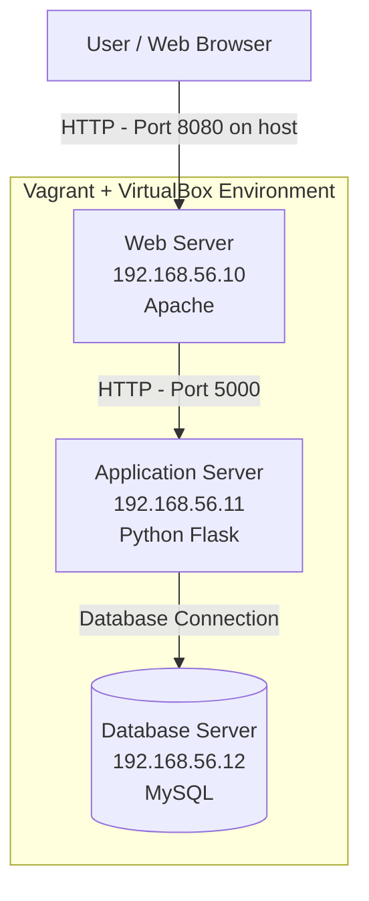

# Vagrant Three-Tier Web Application

A three-tier web application environment built using Vagrant and VirtualBox.

This project demonstrates how separate virtual machines can be used for the web, application, and database layers of an application.

## Architecture

The environment contains three virtual machines:

- Web Server — receives incoming web requests
- Application Server — runs the Flask application
- Database Server — stores application data

## Technologies Used

- Vagrant
- VirtualBox
- Linux
- Python
- Flask
- MySQL
- Apache / Nginx
- Git and GitHub

## Project Goals

The main goals of this project are to:

- Automate the creation of multiple virtual machines
- Configure communication between the three tiers
- Practice Linux networking and service configuration
- Deploy a Flask application
- Connect the application to a database server


## How the Three-Tier Architecture Works

This project uses Vagrant and VirtualBox to create three separate Linux virtual machines, each responsible for a different part of the application.

### 1. Web Server
The web server receives HTTP requests from users and forwards application requests to the Flask server.

### 2. Application Server
The application server runs a Python Flask application. It processes incoming requests, handles application logic, and communicates with the database server.

### 3. Database Server
The database server stores application data using MySQL. It runs separately from the web and application servers.

### Communication Flow

Browser → Web Server → Flask Application → MySQL Database

### Why Use Three Tiers?

Separating the application into three tiers makes it easier to manage each component independently.

It also demonstrates how multiple virtual machines communicate over a private network and how Vagrant can automate the creation of a multi-server environment.


## Prerequisites

Before running this project, ensure the following tools are installed:

- Oracle VirtualBox
- HashiCorp Vagrant
- Git
- A computer with hardware virtualization enabled

### Virtual Machine Requirements

The environment consists of three Ubuntu Linux virtual machines.

Each VM is configured with:
- 2 GB RAM
- 2 virtual CPUs

The complete environment requires approximately 6 GB of allocated VM memory, plus additional memory for the host operating system.

### Getting Started

Clone the repository:

```bash
git clone https://github.com/CloudDevAJ/vagrant-three-tier-app.git
cd vagrant-three-tier-app
```

Verify Vagrant is installed:

```bash
vagrant --version
```

Validate the configuration:

```bash
vagrant validate
```

Start the environment:

```bash
vagrant up
```

Check VM status:

```bash
vagrant status
```

See `docs/testing.md` for the deployment verification checklist.

**Note:** The project currently uses the `hashicorp/bionic64` Ubuntu 18.04 box. This is an older Ubuntu release and should be treated as a lab environment rather than a production-ready deployment.


## Project Limitations

This project was developed as a local virtualization lab to demonstrate three-tier architecture and automated virtual machine provisioning.

The current implementation has several limitations:

- **Local environment:** The infrastructure runs on VirtualBox rather than a cloud platform.
- **Resource requirements:** Three virtual machines require sufficient CPU, memory, and disk space on the host computer.
- **Older operating system:** The project uses Ubuntu 18.04 (`hashicorp/bionic64`), which is no longer suitable as a default choice for new production deployments.
- **Single instance per tier:** Each tier runs on one virtual machine, so the architecture does not provide high availability.
- **Manual deployment:** Vagrant automates VM provisioning, but the project does not currently include a CI/CD deployment pipeline.

### Planned Improvements

Future versions could explore:

- Upgrading to a supported Ubuntu release.
- Containerizing the application with Docker.
- Adding automated configuration testing.
- Implementing monitoring and logging.
- Deploying a similar architecture on AWS.


## Architecture Diagram

The application follows a three-tier architecture using three Linux virtual machines managed through Vagrant and VirtualBox.



### Architecture Overview

- **Web Tier:** Receives user requests and forwards application traffic to the Flask backend.
- **Application Tier:** Processes requests using Python Flask and communicates with the database.
- **Database Tier:** Stores application data using MySQL.
- **Networking:** The three virtual machines communicate through a private VirtualBox network.
- **Provisioning:** Vagrant uses shell scripts to automate virtual machine configuration.

The environment is intended for local development and learning rather than production deployment.

